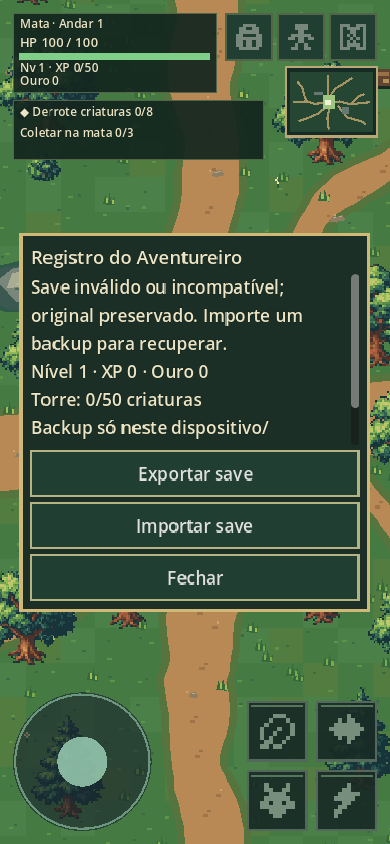
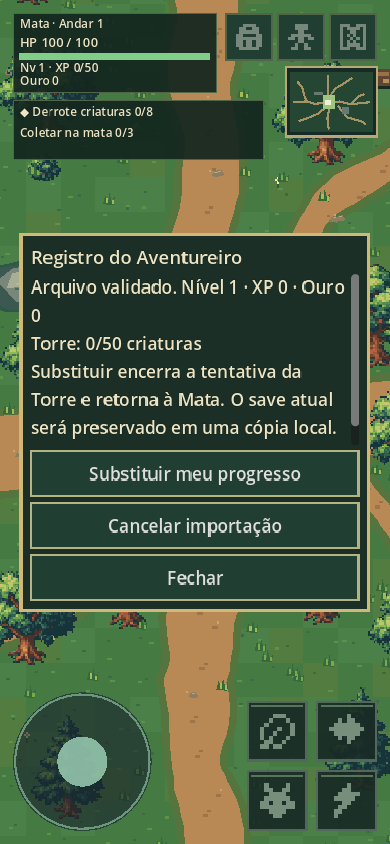
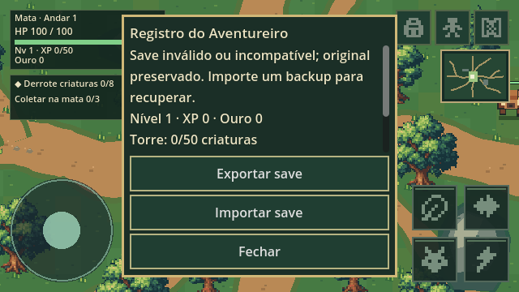

# v0.5.1.1 — O Registro do Aventureiro

Base verificada: ca638629047af7f40fb7b8843d65c2d64b282281.
Branch: feat/andar1-v020-primeiro-passe. Godot 4.5.1.

## Diagnóstico

GameProgress já serializava schema v6 em user://andar1_progress.json:
XP (nível derivado), ouro, kills, mochila/baú, missão atual/progresso/conclusões,
cooldowns de recursos, baús únicos, descobertas, conquistas, atributos,
habilidades, propriedade/upgrades de equipamentos e slots equipados,
andar atual/desbloqueados e requisito permanente da Torre.

Main já salvava derrotas/recompensas, missões, coletas/baús, descobertas,
compra/venda/transferência, Ferreiro, atributos/habilidades, morte,
entrada e retorno da Torre. _ready carregava uma vez, retornando ao acampamento.
HP corrente, posição, inimigos e tentativa não eram dados permanentes.

Na Web, user:// é um filesystem virtual persistido pelo Godot em IndexedDB.
FileAccess.close marca a sincronização assíncrona para os próximos frames.
OS.is_userfs_persistent pode dar falsos positivos. Fonte oficial:
https://docs.godotengine.org/en/4.5/tutorials/export/exporting_for_web.html
A análise do código 4.5.1 confirmou o caminho:
OS::get_user_data_dir usa application/config/name;
OS_Web acrescenta /userfs; engine monta IndexedDB IDBFS em /userfs.
Fontes: core/os/os.cpp, platform/web/os_web.cpp,
platform/web/js/libs/library_godot_os.js e platform/web/js/engine/config.js
no tag 4.5.1-stable do repositório oficial godotengine/godot.

Riscos encontrados: nome do projeto mudava a cada versão, criando outra pasta;
gravação direta truncava o único arquivo antes de finalizar;
save inválido podia iniciar progresso novo e ser sobrescrito;
fechar imediatamente podia interromper o sync assíncrono;
não havia proteção contra outra aba ou backup exportável.

## Correções

Somente na Web: custom_user_dir_name fixo grande-arvore-rpg.
Procura pastas antigas Grande Árvore RPG no IDBFS, em ordem natural de versão.
Migra a mais recente validada; jamais apaga originais ou ignora silenciosamente
uma pasta mais recente inválida. Saves v1–5 continuam migrando por schema,
mantendo .vN.original antes de atualizar o arquivo. Formato corrente segue v6.

Gravação .tmp, flush, leitura de conferência e rename; .bak mantém a cópia anterior
válida. Falhas não substituem deliberadamente dados inválidos/futuros.
Primary truncado pode recuperar .bak em modo protegido, exigindo importação
confirmada para substituir o original. Schema inválido/futuro fica bloqueado.

Journal síncrono localStorage por origem, com envelope SHA-256, cobre fechamento
antes do IndexedDB completar. Na abertura, um journal válido tem prioridade.
Compare-and-swap bloqueia gravações de abas que ficaram desatualizadas.
Cópia .previous preserva o journal anterior. Não é sincronização remota.
IndexedDB continua sendo o filesystem; uma falha do mirror exibe limitação.

Autosave de eventos existentes preservado. Verifica também a cada 30 segundos,
ao perder foco/pausar e em visibilitychange/pagehide. Só grava conteúdo alterado.
Não depende exclusivamente do evento de fechamento, que pode não ocorrer.

Mochila → Registro: status, Exportar save, Importar save. Ações de 44px.
Backup JSON tem formato/versão próprios, SHA-256 do payload, limite 256 KiB
e validação completa do schema. Raw JSON antigo é aceito com aviso de que
a estrutura foi validada, mas não possui checksum de origem.
Preview mostra nível/XP/ouro/Torre; substituir exige confirmação explícita.
Copia o original antes da importação; importa por substituição, nunca soma.
Web usa download_buffer e seletor HTML de arquivo; nativo usa FileDialog.
Importar recarrega a cena na Mata. Menus bloqueiam movimento/ataques.

## Torre

Os 50 abates e recompensas legítimas continuam permanentes.
TowerTrial segue somente em RAM. Morte/abandono encerram a tentativa.
Fechar/recarregar/importar durante uma horda retorna ao acampamento,
sem checkpoint, bônus de recarga, conclusão definitiva ou Andar 2.

## Validação

Local: importação sem erros; 678 verificações GDScript, zero falhas;
9 testes Node do journal, zero falhas; 144 PNGs nativos e zero falhas
nos marcadores combate/Torre/arena/Registro.
Registro: 360×640, 390×844, 640×360, 960×540.
Contratos: save novo, v1–6, persistência completa/+3, arquivos inválidos/futuros,
checksum/versão/tamanho, confirmação/cancelamento, recuperação, migração
preservando original, imports repetidos sem duplicação e controles modais.
Suíte anterior de combate, NPCs, inventário, progressão e Torre preservada.

CI repete contratos/importação/capturas/exportação com templates 4.5.1.
Teste adicional sem dependências npm usa Chromium via CDP e jogo Web exportado:
save novo, pasta anterior em IndexedDB, journal, reload, IndexedDB sem mirror,
fechar/reabrir Chromium no mesmo perfil, mobile/desktop, journal corrompido,
conflito entre abas e seletor de arquivo. Resultado remoto e commit final
são apresentados na entrega; não são presumidos a partir do teste local.

## Verificar no celular

1. Abrir https://arveon-teste.vercel.app/ no mesmo navegador normal.
2. Ganhar XP/ouro/material, equipar ou aprimorar, guardar algo no Baú.
3. Mochila → Registro: conferir status, Exportar save e verificar Downloads.
4. Recarregar, fechar a aba e reabrir o mesmo endereço: conferir valores.
5. Entrar na Torre, derrotar uma criatura e fechar: volta à Mata, requisito
   permanece e nova entrada começa na horda 1.
6. Registro → Importar save → escolher arquivo. Conferir resumo antes de
   Substituir meu progresso; Cancelar mantém os valores.
7. Importar o mesmo backup novamente não soma recompensas.
8. Usar uma única aba ativa; se outra alterou o save, reabrir a aba antiga.

## Limitações

Dados pertencem ao dispositivo, perfil e origem. TESTE e PRODUÇÃO têm saves
separados; mover entre navegadores/domínios exige backup manual.
Não há conta/cloud. Navegação privada, bloqueio, quota e limpeza/remoção dos
dados podem impedir ou apagar persistência. Nenhum evento de saída garante
salvamento após o sistema matar o processo; eventos importantes/journal reduzem
a janela. SHA-256 detecta corrupção, não autentica um jogador ou impede edição
deliberada do arquivo. Downloads/seletor dependem das políticas do navegador,
especialmente Safari/iOS. Não validado em aparelho físico ou Safari.
Originais inválidos não são apagados; devem ser recuperados por backup.
Sem Guardião, Andar 2, balanceamento, mapa, arte, main ou produção.

## Arquivos

- scripts/components/game_progress.gd
- scripts/platform/browser_save.gd
- scripts/platform/browser_save.gd.uid
- scripts/platform/browser_save.js
- scripts/main.gd
- ui/hud.gd
- ui/save_panel.gd
- ui/save_panel.gd.uid
- project.godot
- export_presets.cfg
- tests/save_tests.gd
- tests/save_tests.gd.uid
- tests/run_tests.gd
- tests/browser_save_tests.cjs
- docs/decisions/SAVE_V0511.md
- docs/design/GAME_DESIGN.md
- .github/workflows/web.yml
- tests/web_save_browser.mjs
- tests/save_capture.gd
- tests/save_capture.gd.uid
- docs/ARCHITECTURE.md
- docs/iterations/V0.5.1.1_REGISTRO.md
- docs/qa/v0511/registro-mobile.png
- docs/qa/v0511/confirmacao-mobile.png
- docs/qa/v0511/registro-desktop.png

