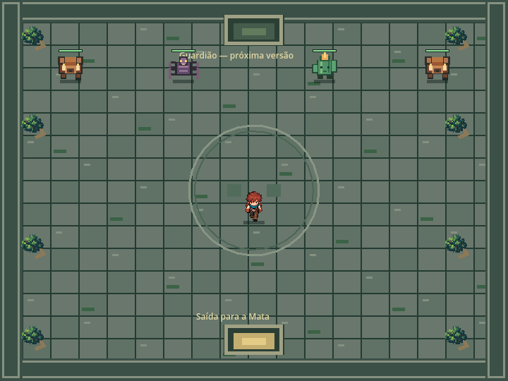
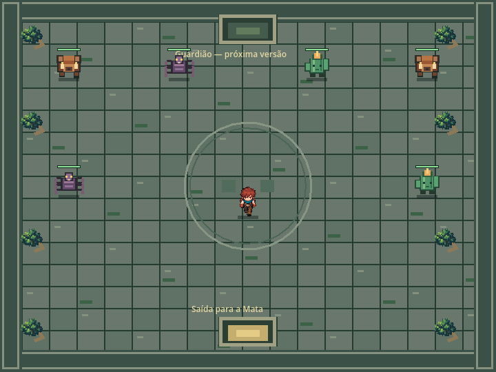
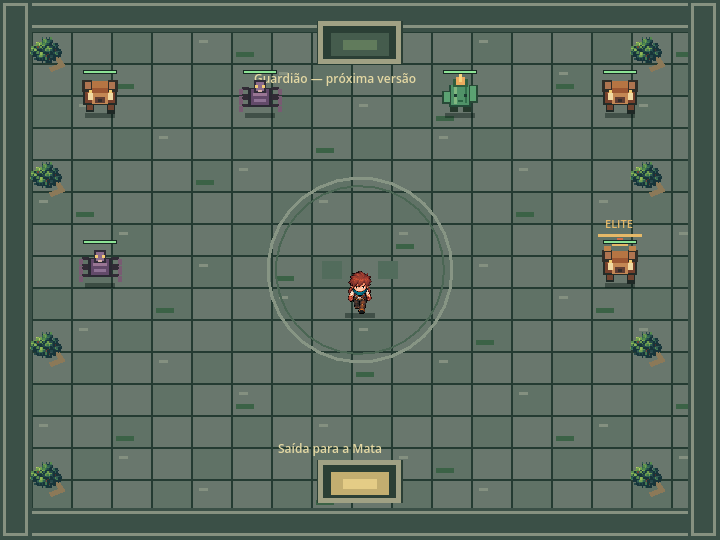
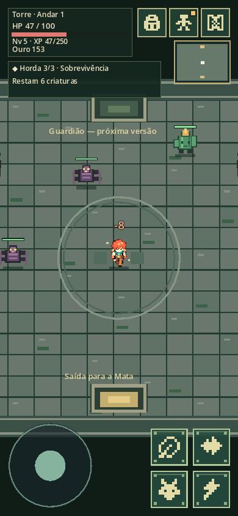
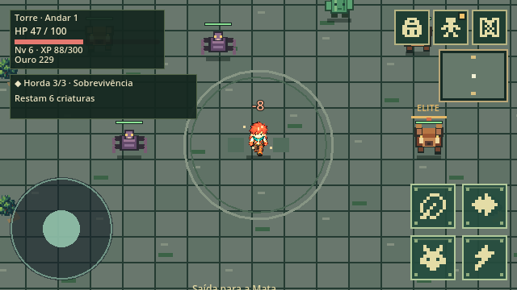
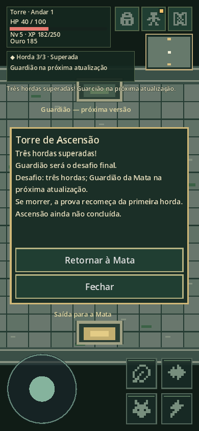
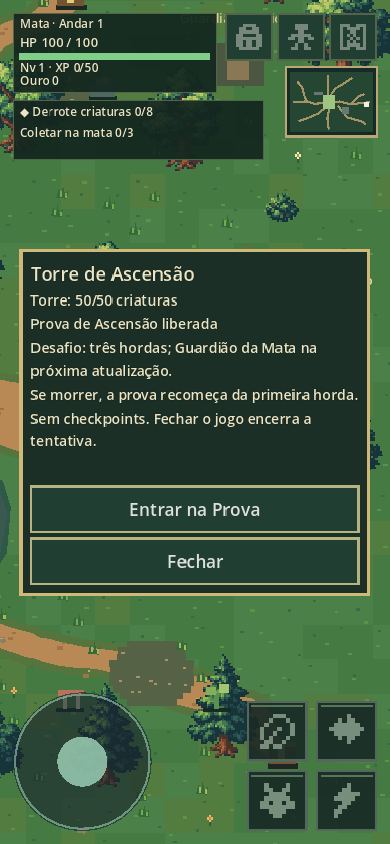

# v0.5.1 — As Hordas da Torre

Base verificada: `0645ef8fd6f2e1f57319657115402f9d85795149`.
Branch: `feat/andar1-v020-primeiro-passe`. Engine: Godot 4.5.1.
Autorização: pedido explícito de Thiago nesta conversa.

## Comportamento

A Torre existente (1130, 455) continua bloqueada antes de 50 mortes reais da Mata.
Entrada, recursos, limites 1200×900 e cena da Mata não foram modificados.
Após liberar, Interagir → Entrar na Prova transfere o mesmo protagonista à cena
separada de pedra, raízes e musgo (720×540), com quatro paredes físicas.
Nível, atributos, HP, equipamentos, inventário, ouro e progressão permanecem.

Horda 1: 4 comuns. Horda 2: 6 comuns. Horda 3: 5 comuns e 1 elite.
Variantes, estatísticas, efeitos e recompensas existentes são reutilizados.
Máximo de seis criaturas na arena; limite da Mata continua cinco.
Spawns ficam a pelo menos 170 pixels do jogador e 90 entre si.
Preparação de quatro segundos antes de cada horda; movimento permitido.
Somente a morte real, única, de um membro da tentativa atual reduz a contagem.
Remoções e eventos duplicados não avançam. Cada horda inicia uma única vez.

Entre 1–2 e 2–3: cura única de 15% do HP máximo, arredondada para cima,
limitada ao máximo. Nenhuma cura após a terceira horda.
Menus pausam ações e temporizadores. Transições bloqueiam comandos duplicados.
Saída sul permite abandonar por Interagir e confirmar no painel.
Morte na arena aplica a penalidade normal uma vez e retorna ao acampamento.
Abandono não aplica penalidade nem cura. Nova entrada sempre começa na horda 1.

A tentativa fica somente na memória; save v6 e migrações antigas permanecem.
Carregar durante a prova encerra a tentativa e usa o retorno normal ao acampamento.
O requisito permanente e recompensas salvas permanecem. Não existem checkpoints.
Após a terceira horda, painel informa o futuro Guardião e oferece retorno.
Não conclui ascensão, concede selo, libera Andar 2 ou teletransporte futuro.

## Validação local

- Importação Godot 4.5.1: sem erros de scripts.
- Suíte completa: **620 verificações, 0 falhas**.
- Máquina de estados isolada: 63 verificações, 0 falhas (incluídas nas 620).
- Renderização nativa GL por software: **128 PNGs**, sem erros.
  43 layouts mobile, 28 combate, 22 Torre, 35 arena.
- Arena: 360×640, 390×844, 640×360 e 960×540, incluindo preparação,
  três hordas, impacto/dano, dois intervalos e conclusão.
- Testes reais de toque, joystick, dash e três habilidades; abertura/fechamento
  do painel, controles bloqueados em modal e quatro paredes físicas.
- Diagnóstico inicial da Mata: 191,04 ms, 145 nós, 63 colliders,
  29364,8 KiB de memória estática. Não é medição de FPS em celular.

Os contratos cobrem bloqueio/desbloqueio, transição e estado do protagonista,
quantidades, duplicação, remoção sem morte, cura única, elite, morte na horda 2,
reinício na 1, abandono, retorno, recarga, saves antigos e ausência de Andar 2.
A suíte anterior continua verificando combate, NPCs, inventário e progressão.
CI configurado para repetir importação, suíte, 128 capturas e exportação Web
com templates 4.5.1, antes de publicar exclusivamente o alias TESTE.
O resultado remoto e o commit final são informados na entrega após o CI.

## Testar no celular

1. Abrir https://grande-arvore-rpg-teste.vercel.app/ em navegador com WebGL 2.
2. Derrotar 50 criaturas da Mata; o requisito persiste após morte/carregamento.
3. Caminhar até a Torre leste (1130, 455), tocar Interagir e Entrar na Prova.
4. Movimentar pelo joystick; testar ataque automático, dash e habilidades.
5. Derrotar 4, depois 6, depois 5 comuns + elite. Conferir os dois intervalos.
6. Na saída sul, Interagir permite abandonar sem penalidade.
7. Após a terceira horda, tocar Retornar à Mata.
8. Reentrar, morrer ou recarregar durante a prova: a próxima tentativa começa na 1.
9. Repetir em orientação vertical/horizontal. Não há botão de iniciar Guardião.

## Evidências

## Limitações

Guardião, selo e ascensão definitiva ficam para avaliação futura.
Recompensas normais são concedidas uma vez por morte real; repetir exige novas
mortes, como no combate normal da Mata. Não existe bônus de entrada/conclusão.
A IA original não ganhou pathfinding; arena aberta facilita movimentação.
Poção conserva o slot reservado/inativo já existente, sem nova mecânica.
Validação mobile automatizada em viewport e GL nativo; não em aparelho físico,
nem teste de FPS mobile. Navegador remoto disponível não oferece WebGL 2.
Exportação Web deve ser comprovada pelo CI; não equivale a gameplay Web em celular.

## Arquivos modificados

- `scripts/components/tower_trial.gd`
- `scripts/components/tower_trial.gd.uid`
- `scripts/components/health.gd`
- `tests/tower_trial_state_tests.gd`
- `tests/tower_trial_state_tests.gd.uid`
- `docs/decisions/TORRE_V051.md`
- `docs/design/GAME_DESIGN.md`
- `scripts/main.gd`
- `scenes/world/tower_arena.tscn`
- `scripts/presentation/tower_arena_view.gd`
- `scripts/presentation/tower_arena_view.gd.uid`
- `scripts/actors/enemy.gd`
- `scripts/components/enemy_projectile.gd`
- `ui/hud.gd`
- `ui/minimap.gd`
- `project.godot`
- `tests/tower_trial_tests.gd`
- `tests/tower_trial_tests.gd.uid`
- `tests/run_tests.gd`
- `tests/tower_tests.gd`
- `tests/arena_capture.gd`
- `tests/arena_capture.gd.uid`
- `tests/tower_capture.gd`
- `.github/workflows/web.yml`
- `docs/ARCHITECTURE.md`
- `docs/iterations/V0.5.1_HORDAS_TORRE.md`
- `docs/qa/v051/horda-1.png`
- `docs/qa/v051/horda-2.png`
- `docs/qa/v051/horda-3.png`
- `docs/qa/v051/combate-mobile.png`
- `docs/qa/v051/elite-desktop.png`
- `docs/qa/v051/conclusao-mobile.png`
- `docs/qa/v051/entrada-mobile.png`

Nenhuma alteração em main, produção, arte do Explorador, save/progressão permanente,
cena/limites da Mata ou localização da Torre. Alteração local antiga em
CI_PREVIEW_FIX.md foi excluída desta entrega.

